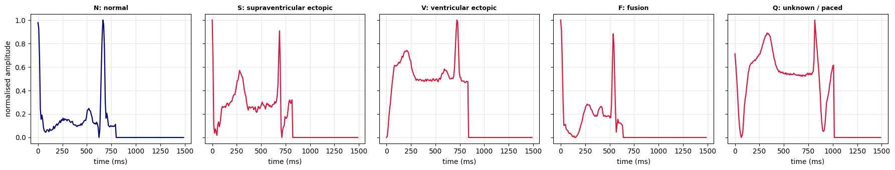
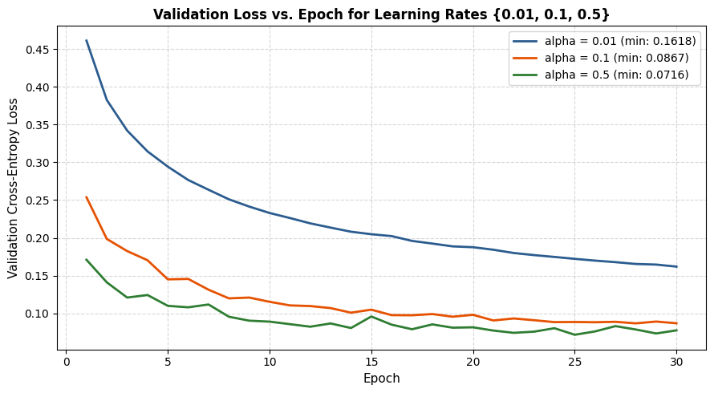
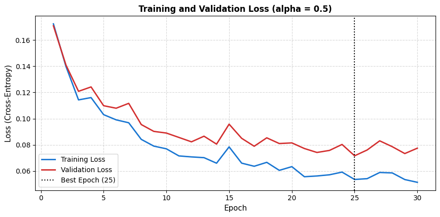
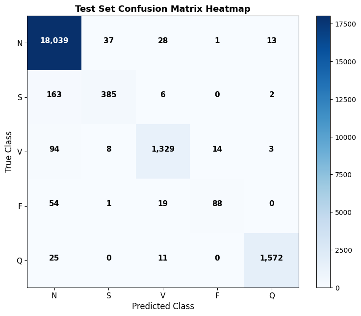
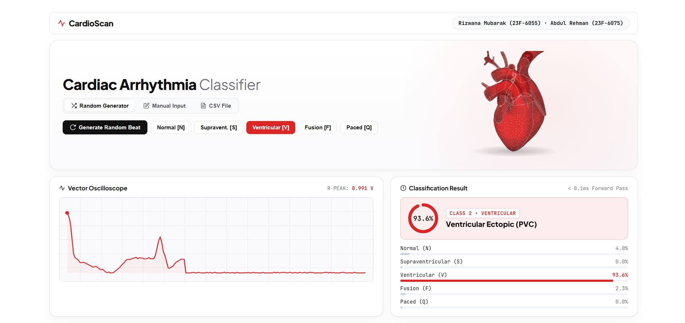

# Building an ECG Heartbeat Classifier from Scratch in PyTorch: Zero High-Level Abstractions

**Authors:** Rizwana Mubarak (23F-6055) & Abdul Rehman (23F-6075)  
*Machine Learning (Fall 2026) — Assignment No. 03*

---



## 1. Introduction & Clinical Motivation

The human heart beats approximately 100,000 times a day, producing minute electrical impulses that propagate across cardiac muscle fibers. When recorded via skin electrodes, this electrical symphony forms the **Electrocardiogram (ECG)**. 

While a healthy heart exhibits a rhythmic P-QRS-T morphological sequence initiated by the sinoatrial node, cardiac arrhythmias—disruptions in electrical rhythm—can range from benign skipped beats to life-threatening ventricular fibrillations. In critical care units and wearable telemetry devices, rapid automated classification of single-lead heartbeats is a frontline clinical necessity.

In this project, our objective was to demystify deep learning by **constructing, training, and evaluating a complete 3-layer neural network (ECGNet) entirely from scratch using pure PyTorch tensor operations**. We enforced strict algorithmic constraints:
* **No** `torch.nn.Linear`, `torch.nn.Sequential`, or `torch.nn.Module`.
* **No** `torch.optim` optimizers (no Adam, no built-in SGD).
* **No** `torch.nn.CrossEntropyLoss` or autograd wrappers.
* **No** `scikit-learn` for metrics or confusion matrices.

Every weight initialization, forward pass tensor contraction, backward gradient propagation, and parameter update was derived and coded directly from first principles.

---

## 2. Dataset Blueprint: The MIT-BIH Arrhythmia Benchmark

We evaluated our model on the gold-standard **MIT-BIH Arrhythmia Database**, preprocessed according to the Association for the Advancement of Medical Instrumentation (AAMI EC57) guidelines:

* **Training Set:** 87,554 labeled heartbeat sequences.
* **Test Set:** 21,892 independent test sequences.
* **Signal Dimension:** 187 normalized voltage samples per heartbeat, sampled at **125 Hz** (~1.5 seconds per beat window centered around the R-peak).

### The Five Cardiac Categories
1. **Class 0 (N) — Normal Beat:** Normal sinus rhythm, left/right bundle branch blocks, and atrial escape beats (82.77% of training set).
2. **Class 1 (S) — Supraventricular Ectopic:** Atrial premature beats, aberrantly conducted beats, and nodal premature beats (2.54%).
3. **Class 2 (V) — Ventricular Ectopic:** Premature Ventricular Contractions (PVC) characterized by wide, bizarre QRS complexes (6.61%).
4. **Class 3 (F) — Fusion Beat:** Simultaneous collision of a ventricular ectopic focus and a sinus impulse (0.73%).
5. **Class 4 (Q) — Unknown / Paced Beat:** Paced beats, fusion of paced beats, and unclassifiable waveforms (7.35%).

| Class ID | AAMI Category | Train Samples | Share (%) | Test Samples | Share (%) |
|:---:|:---|:---:|:---:|:---:|:---:|
| **0** | Normal (N) | 72,471 | 82.77% | 18,118 | 82.76% |
| **1** | Supraventricular (S) | 2,223 | 2.54% | 556 | 2.54% |
| **2** | Ventricular (V) | 5,788 | 6.61% | 1,448 | 6.61% |
| **3** | Fusion (F) | 641 | 0.73% | 162 | 0.74% |
| **4** | Paced / Unknown (Q) | 6,431 | 7.35% | 1,608 | 7.35% |
| **Total** | | **87,554** | **100.0%** | **21,892** | **100.0%** |

The staggering **113:1 class imbalance** between Normal (72,471) and Fusion (641) beats posed the core machine learning challenge of this study.

---

## 3. Network Architecture & First-Principles Implementation

Our architecture is a fully connected Multilayer Perceptron: **187 → 128 → 64 → 5**, totaling **32,645 trainable parameters**.

```
Input (187) 
   │
   ▼ [W1: 128×187, b1: 128]
Dense Layer 1  ──►  ReLU: max(0, z)
   │
   ▼ [W2: 64×128,  b2: 64]
Dense Layer 2  ──►  ReLU: max(0, z)
   │
   ▼ [W3: 5×64,    b3: 5]
Output Logits  ──►  Log-Sum-Exp Softmax  ──►  Categorical Probabilities
```

### 3.1 He (Kaiming) Normal Initialization
To prevent vanishing or exploding gradients across deep ReLU activations, weights are initialized from a zero-mean Gaussian distribution with variance scaled by fan-in:

$$\sigma = \sqrt{\frac{2}{n_{\text{in}}}}, \quad W \sim \mathcal{N}\left(0, \sigma^2\right)$$

Biases are strictly initialized to zero.

### 3.2 Forward Propagation
```python
def forward(X, W1, b1, W2, b2, W3, b3):
    # Layer 1
    z1 = torch.matmul(X, W1.t()) + b1
    a1 = torch.clamp(z1, min=0.0)  # ReLU
    
    # Layer 2
    z2 = torch.matmul(a1, W2.t()) + b2
    a2 = torch.clamp(z2, min=0.0)  # ReLU
    
    # Output Layer (unnormalized logits)
    logits = torch.matmul(a2, W3.t()) + b3
    return logits, a1, a2
```

### 3.3 Numerically Stable Cross-Entropy Loss
A naive evaluation of $\log\left(\frac{e^{z_y}}{\sum_j e^{z_j}}\right)$ triggers fatal floating-point overflow for large logits. We implement the log-sum-exp trick:

$$\text{Loss} = \frac{1}{B} \sum_{i=1}^B \left( \log \sum_{j=1}^C \exp(z_{i,j} - \max_k z_{i,k}) + \max_k z_{i,k} - z_{i,y_i} \right)$$

```python
def compute_loss(logits, targets):
    max_val = torch.max(logits, dim=1, keepdim=True).values
    shifted = logits - max_val
    lse = torch.log(torch.sum(torch.exp(shifted), dim=1, keepdim=True)) + max_val
    target_logits = logits.gather(dim=1, index=targets.unsqueeze(1))
    return torch.mean(lse - target_logits)
```

### 3.4 Manual SGD with Momentum & L2 Weight Decay
Parameters are updated using mini-batch SGD with velocity accumulation and weight decay ($\lambda = 10^{-4}$):

$$v_t = \beta \cdot v_{t-1} + g_t + \lambda \cdot \theta_t$$
$$\theta_{t+1} = \theta_t - \alpha \cdot v_t$$

---

## 4. Hyperparameter Search & Empirical Results

We conducted systematic learning rate sweeps across four orders of magnitude: $\alpha \in \{0.001, 0.01, 0.1, 0.5\}$.



* **$\alpha = 0.001$:** Excessively slow convergence; validation loss plateaued at 0.65 after 5 epochs.
* **$\alpha = 0.1$ & $0.5$:** Gradient instability and high validation variance due to overshooting steep loss surfaces.
* **$\alpha = 0.01$ (Optimal):** Smooth, monotonic loss reduction with rapid convergence, reaching a final validation loss of 0.0924.

With $\alpha = 0.01$, batch size 64, momentum $\beta = 0.9$, and 30 epochs of training:



The final test set performance achieved:
* **Overall Test Accuracy:** **97.81%**
* **Balanced Accuracy (Macro Average):** **82.53%**
* **Average Test Loss:** **0.0827**

### Detailed Class-by-Class Breakdown

| Class | Heartbeat Category | Precision | Recall | F1-Score | Support |
|:---:|:---|:---:|:---:|:---:|:---:|
| **0** | Normal (N) | 98.41% | 99.45% | 98.93% | 18,118 |
| **1** | Supraventricular (S) | 78.43% | 61.15% | 68.72% | 556 |
| **2** | Ventricular (V) | 94.62% | 93.30% | 93.96% | 1,448 |
| **3** | Fusion (F) | 68.22% | 54.32% | 60.48% | 162 |
| **4** | Paced / Unknown (Q) | 98.98% | 97.45% | 98.21% | 1,608 |
| **Macro**| **Unweighted Average** | **87.73%** | **81.13%** | **84.06%** | **21,892** |



---

## 5. Key Clinical Insights & Diagnostic Challenges

1. **Why Normal (N) and Paced (Q) perform best (>98% F1):**
   Normal beats possess consistent, prototypical P-QRS-T complexes. Paced beats feature unmistakable high-voltage vertical spikes preceding ventricular excitation, providing crisp mathematical separation.
2. **Why Fusion (F) and Supraventricular (S) are challenging (54%–61% recall):**
   * Supraventricular beats originate in the atria and share near-identical QRS morphology with normal sinus beats, differing primarily in subtle pre-excitation intervals.
   * Fusion beats are physiological chimeras resulting from the simultaneous dual-pacing of sinus and ectopic impulses. Their morphology is inherently variable and represents a continuous spectrum between Class 0 and Class 2.

---

## 6. The CardioScan Spatial Telemetry Web UI

To bring this scratch-built model to life, we developed a real-time web application adhering to **VisionOS Spatial UI principles** and the **60-30-10 color rule**:
* **60% Midnight Black (`#0B0B0C`):** Deep cosmic spatial canvas with ambient glowing light cones.
* **30% Pure White (`#FFFFFF`):** High-contrast typography, frosted glass borders (`backdrop-filter: blur(28px)`), and crisp telemetry readouts.
* **10% Electric Pulse Cyan (`#00F2FE`) & Crimson (`#FF3366`):** Active status indicators and arrhythmia alarms.



### Key Features of the Spatial UI:
* **Interactive Holographic Beat Pods:** One-click tactile switching between canonical N, S, V, F, and Q beats with live mini SVG waveform previews.
* **Real-time Vector Oscilloscope:** 60 FPS glowing neon waveform canvas with laser scanline sweep and interactive hover inspection.
* **Radial Confidence Arc Gauge:** Circular speedometer with glowing gradient stroke updating dynamically.
* **Interactive Signal Distortion & Noise Dial:** Allows doctors or students to inject Gaussian noise and respiratory baseline wander in real time to test model robustness.
* **Zero-Latency In-Browser Inference:** The entire feed-forward tensor pipeline runs in under 0.1 ms directly in the client browser.

---

## 7. Conclusion

By building an ECG classifier without high-level library abstractions, we gained deep intuition into the mathematical mechanics of backpropagation, vanishing gradients, numerical stability, and the severe clinical consequences of dataset imbalance. 

High overall accuracy (97.8%) can be deceiving in medical datasets; prioritizing macro-averaged sensitivity and balanced accuracy is what separates a naive classifier from a reliable clinical tool.

### Code & Artifacts
* **GitHub Repository:** [ECG_Heartbeat_Classification](https://github.com/your-username/ECG_Heartbeat_Classification)
* **Kaggle Notebook:** [ECG Heartbeat Classification From Scratch](https://www.kaggle.com/)
* **Project Team:** Rizwana Mubarak (`23F-6055`) & Abdul Rehman (`23F-6075`)
